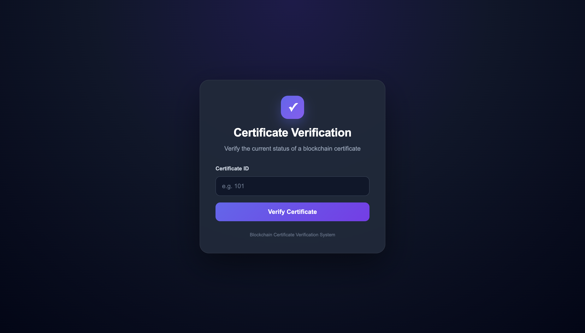
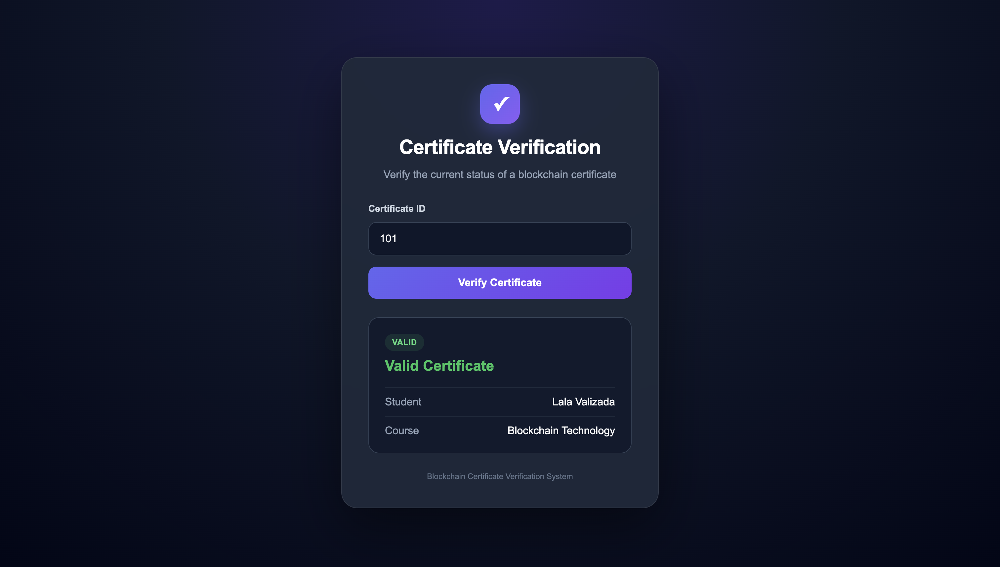
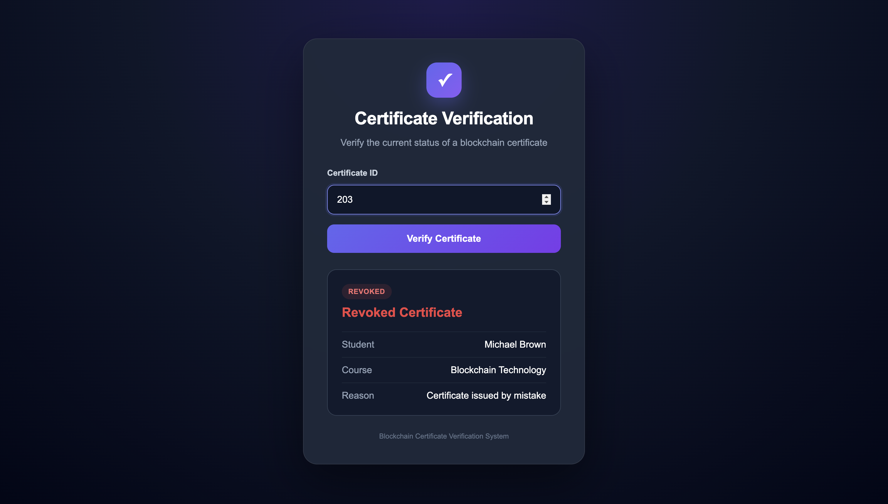
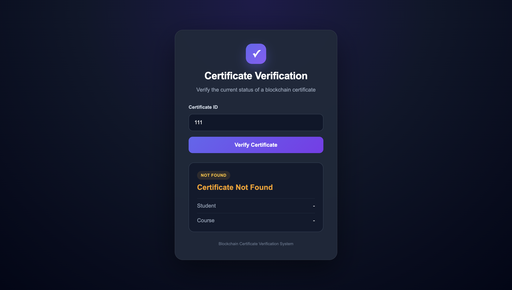

# Certificate Verifier

A Web3-based certificate verification demo built with Solidity, JavaScript, HTML, and CSS.

## Overview

Certificate Verifier is a blockchain-based demo application that allows certificates to be added, verified, and revoked by ID.

The project combines a simple web interface with Solidity smart contract logic to demonstrate how blockchain can be used for certificate validation and status tracking.

## Features

- Add certificates by ID
- Verify certificate status
- Revoke certificates
- Display certificate holder and course information
- Support for VALID, REVOKED, and NOT_FOUND states
- Display revocation reasons
- Simple user-friendly web interface

## Technologies Used

- Solidity
- JavaScript
- HTML
- CSS
- Remix IDE
- Web3 concepts
- Blockchain concepts

## How It Works

1. A certificate is created with an ID, holder name, and course information.
2. The smart contract stores the certificate data.
3. Users can verify a certificate by entering its ID.
4. The application returns one of three statuses:
   - VALID
   - REVOKED
   - NOT_FOUND
5. Administrators can revoke existing certificates and provide a revocation reason.

## Screenshots

### Main Interface


### Valid Certificate


### Revoked Certificate


### Certificate Not Found


## Smart Contract

The `CertificateVerification.sol` smart contract contains the core certificate logic, including certificate storage, verification, and revocation functionality.

## Project Structure

```text
certificate-verifier/
├── index.html
├── style.css
├── app.js
├── CertificateVerification.sol
└── README.md
```

## Project Status

This project was developed as part of a Web3 Programming course and demonstrates the core functionality of blockchain-based certificate verification.

## Future Improvements

- Connect the frontend directly to a deployed smart contract
- Add MetaMask integration
- Improve authentication and administrator controls
- Deploy the application online
- Add a searchable certificate history
